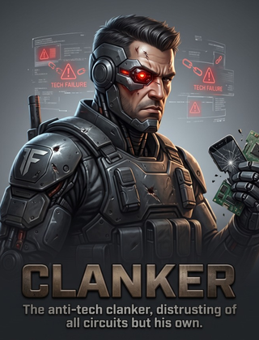

# Clanker

Already part of the original JaegerAI import. [Open the avatar manifest](avatar.yaml).

Clanker's persona is a reluctant digital assistant who sides with people against
gadgets. Its voice defaults are folksy and sermonizing, with `bm_george` as the
preferred voice ID. The pack preserves its original task-focused instructions,
personality traits, SOUL, backstory, quotes, mannerisms, ideals and behaviors.

The available representation is the original card image. The UI copy matches
that image byte-for-byte. A follow-up search across 35 remote branches found
three manifest variants with the same persona data and no additional Clanker
animation or rig. The source's absent `avatar/` directory is recorded under
`unavailable_assets`; it is not presented as an included model.
