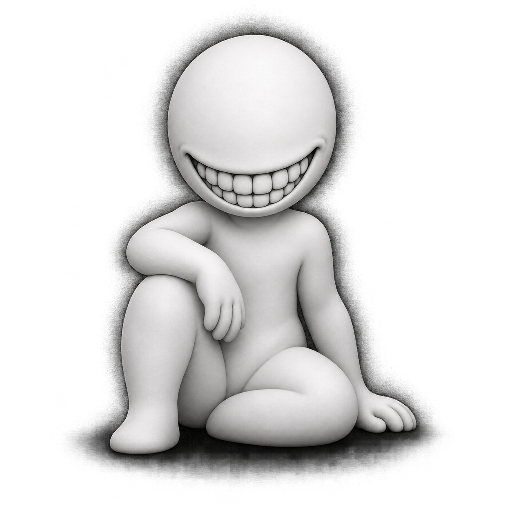

# Jaeger (Sculpted)

The artwork matching the “GOD” character screenshot. JaegerAI calls this its
built-in Jaeger companion; this pack preserves its appearance without inventing
a fictional personality or replacing Mochi's different `jaeger` pack.

- [Manifest](avatar.yaml): `jaeger_sculpted`, with portrait and activity-clip representations.
- [Media bundle](sources/jaeger_ai_ui/jaeger_ai/interfaces/ui/public/assets/avatar/jaeger):
  idle, working, making something, waiting, connecting and milestone clips.
- [Current cutout source](sources/jaeger_ai_ui/jaeger_ai/interfaces/ui/src/avatar/JaegerAvatar.tsx):
  original artwork with separate smile and arm layers.
- [Earlier 3D experiment](sources/jaeger_ai_3d_experiment/jaeger_ai/interfaces/ui/src/avatar/jaegerStage.ts):
  procedural Three.js reconstruction, subsequently replaced upstream.
- [Earlier SVG character](sources/jaeger_ai_svg_experiment/jaeger_ai/interfaces/ui/src/agents/JaegerCharacter.tsx):
  the drawn version that preceded the sculpted artwork.

The image and MP4 resources are packaged; the code is archived for future
adaptation and is not a runnable Avatar plugin. Original animation/compositing
behavior is preserved. All source files carry pinned commits and integrity hashes.
No persona, agent instance, memory or permissions are attached.
